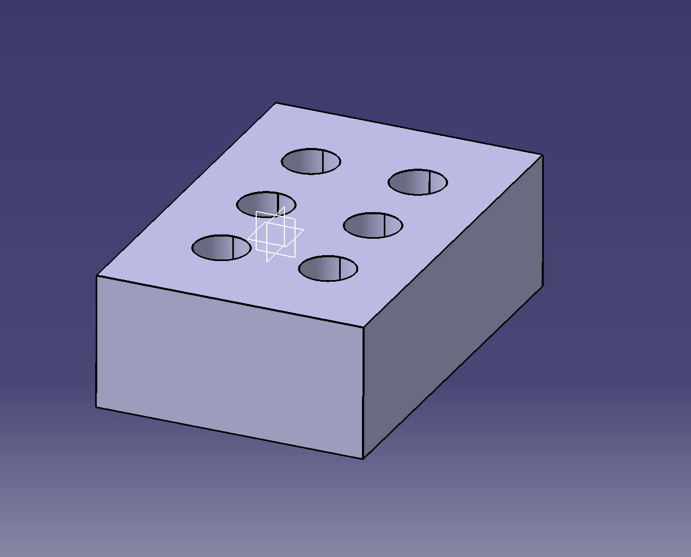
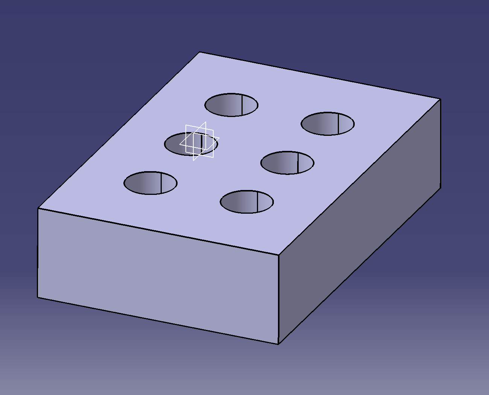
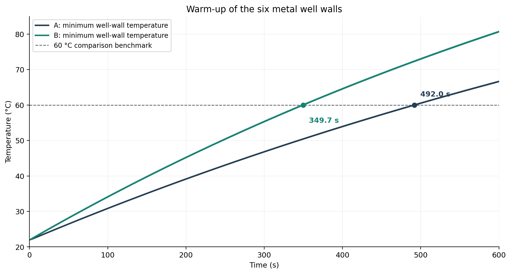
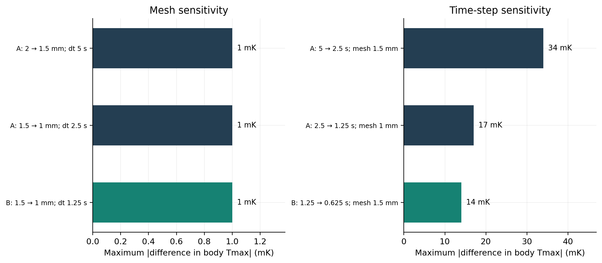
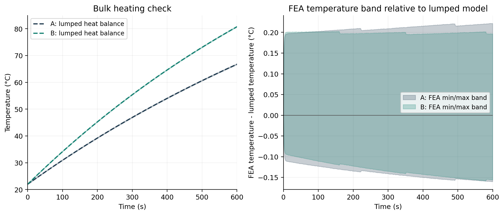

# Diagnostic Sample Heater - CAD and Thermal Analysis

**Ayaz Hussain | CATIA V5 · Ansys Mechanical · Python**

I modelled a six-well aluminium sample holder in CATIA and compared two block heights in a transient thermal analysis. Python postprocessing links the exported Ansys histories to warm-up times, temperature uniformity and a bulk heat-balance calculation.

Reducing the height from **20 mm to 15 mm** saves **33.24 g of aluminium (27.0%)**. Under the same **10 W input**, the minimum temperature on the selected well walls reaches the **60 °C comparison benchmark 28.9% sooner**. The thinner block also has a slightly larger wall-temperature range.

| Design A - 20 mm | Design B - 15 mm |
|---|---|
|  |  |

## Work completed

- Built both holders with the same footprint, well diameter and well depth.
- Applied a constant base heat input and convection to the remaining surfaces.
- Compared eight solved cases, changing mesh size or time step within each pair.
- Processed whole-body and cylindrical well-wall temperature histories.
- Calculated warm-up times, aluminium mass and a lumped thermal response.
- Reviewed temperature sensitivity and the remaining variation in local heat-flux peaks.

## Design comparison

Both selected cases use a nominal 1 mm mesh, a fixed 1.25 s time step and a 600 s duration.

| Quantity | Design A | Design B |
|---|---:|---:|
| Overall height | 20 mm | 15 mm |
| Solid floor beneath the wells | 8 mm | 3 mm |
| Calculated aluminium mass | 122.94 g | 89.70 g |
| Minimum well-wall temperature reaches 60 °C | 492.0 s | 349.7 s |
| Minimum well-wall temperature reaches 65 °C | 572.7 s | 405.3 s |
| Wall-temperature range at the 60 °C crossing | 0.177 °C | 0.227 °C |
| Wall-temperature range at 600 s | 0.183 °C | 0.234 °C |
| Whole-body temperature at 600 s | 66.593-66.974 °C | 80.617-80.969 °C |



Warm-up time is interpolated from the minimum temperature across the cylindrical walls of all six wells. The flat well floors are excluded from this particular result. The 60 °C and 65 °C values are comparison benchmarks chosen for the study.

B reaches 60 °C about **142.2 s earlier**. Its wall-temperature range at that point is **0.050 °C larger**. The result favours B for mass and warm-up time, while A has the smaller spatial wall range under the specified conditions.

## Thermal model

The holders have a **60 × 40 mm footprint** and six **Ø8 mm, 12 mm-deep blind wells**. The material is Ansys built-in Aluminum Alloy, with density 2770 kg/m³, specific heat 875 J/(kg·K) and temperature-dependent conductivity.

Initial and ambient temperatures are 22 °C. A constant 10 W acts on the full 2400 mm² base opposite the well openings. The other surfaces, including the well walls and floors, use a prescribed convection coefficient of 10 W/(m²·K).

The analysis predicts the temperature of the metal holder with empty wells. Tubes, fluid samples, contact resistance, fixtures, radiation and a temperature controller are outside this model. Sample temperature and controlled holding performance would need further analysis and testing.

## Numerical checks

The controlled mesh comparisons change whole-body temperature extrema by about **0.001 °C**, at the exported display resolution. The finer A time-step comparison changes the temperature maximum by up to **0.017 °C** and the minimum by **0.018 °C** over the full history. The B time-step check gives **0.014 °C** and **0.016 °C**, respectively.



These are observed sensitivities, not absolute error bounds. The wall-specific histories were exported for the selected cases only, so a separate convergence bound for wall spread has not been established.

The local heat-flux peak remains mesh sensitive: its 600 s maximum rises by about **13-17%** with refinement. The peak is therefore retained for interpretation rather than used as a converged design limit. Ansys Total Heat Flux is a local magnitude in W/mm²; it is distinct from the applied 10 W power.

[Complete case results](results/case_summary.csv) · [Controlled comparisons](results/refinement_checks.csv)

## Heat-balance calculation

The calculation subtracts the wells from the solid volume, then uses:

```text
C = density × solid volume × specific heat
C dT/dt = P - h A_conv (T - T_ambient)
```

It predicts **66.753 °C for A** and **80.772 °C for B** at 600 s. Both fall inside the corresponding whole-body FEA temperature range. The initial Biot estimates are approximately 0.00036 and 0.00030, supporting a nearly uniform bulk model.



This checks consistency under shared power and heat-loss assumptions. The bulk model does not resolve local wall gradients. A separate [convection sensitivity calculation](figures/generated/convection_sensitivity.png) shows how the assumed heat loss affects the result.

## Read the study

- [Technical report - PDF](docs/Heater_Thermal_Design_Report.pdf)
- [Calculation method and walkthrough](docs/calculation_walkthrough.md)
- [Geometry, material and modelling assumptions](docs/model_and_assumptions.md)
- [Evidence index](docs/evidence_index.md) and [technical references](docs/references.md)

All 45 original images and 18 numerical exports are retained. Display copies are cropped only; the source files and crop records are included. Native CAD and Workbench projects are held separately.

## Run the calculations

Python 3.10 or later:

```bash
python -m pip install -r requirements.txt
python scripts/analyse.py
python -m unittest discover -s tests -v
python scripts/build_report.py
```

The scripts regenerate the processed tables, figures and report from the included exports. They do not launch CATIA or Ansys. All 18 histories are checked for row count, fixed time grid, finite values and correctly ordered minima, averages and maxima. The original timestamps are retained alongside the calculation clock where the GUI export rounds 0.625 s intervals.
